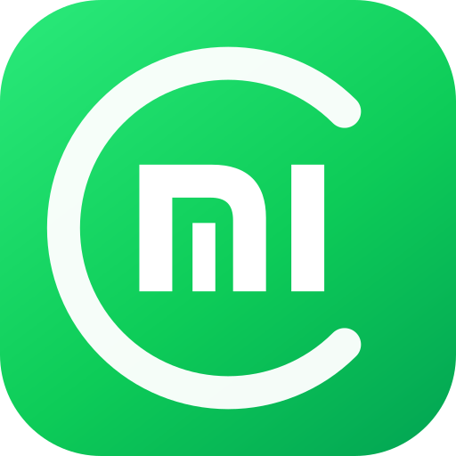
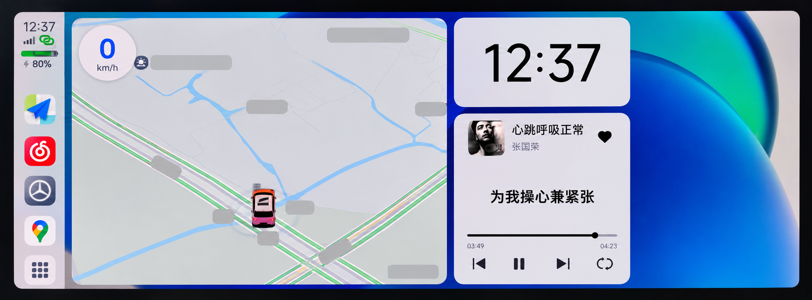
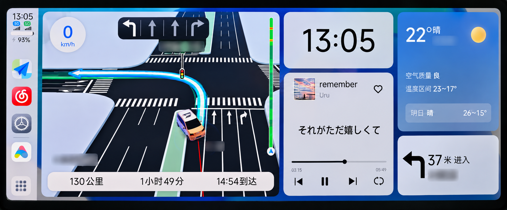
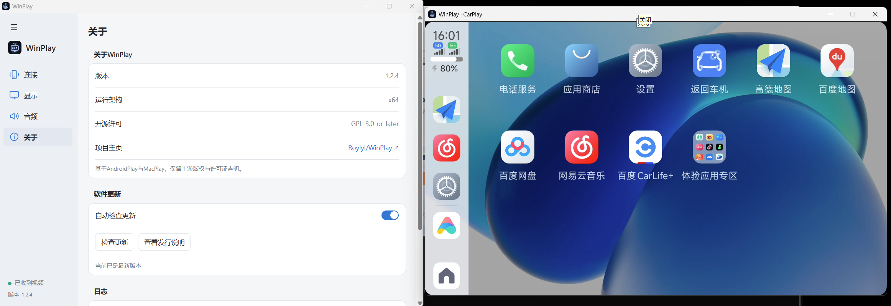
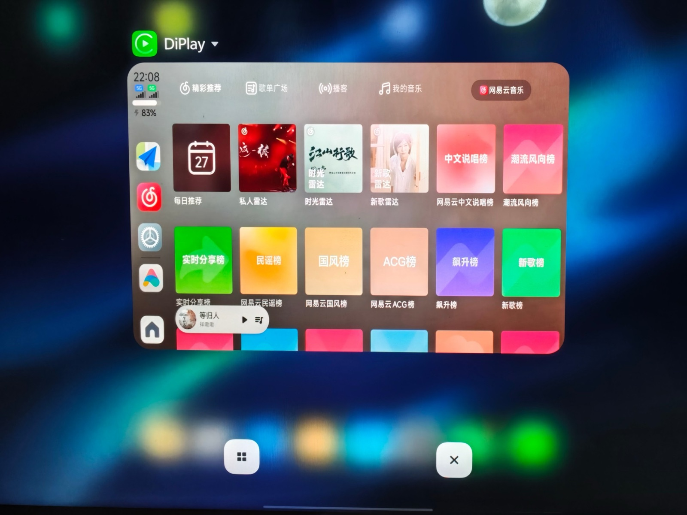

# mcarplay



[](https://github.com/wangxso/mcarplay/actions/workflows/android-ci.yml)
[](https://github.com/wangxso/mcarplay/releases)
[](https://github.com/wangxso/mcarplay/releases)
[](#install-and-connect)
[](LICENSE)
[](#status)
[](https://github.com/wangxso/mcarplay/stargazers)

**[English](README.md) | [简体中文](README.zh-CN.md)**

[Changelog](CHANGELOG.md) · [Releases](https://github.com/wangxso/mcarplay/releases)

Bridge Xiaomi CarWith to a wireless CarPlay receiver using an Android APK.
mcarplay receives native CarWith video and audio on the phone, sends them to the
receiver, and routes receiver touch events back to CarWith. The displayed
interface is CarWith, rather than the iOS CarPlay application interface.

## Status

Experimental, with working Xiaomi-to-DiPlay and Xiaomi-to-WinPlay 1.2.5 test setups and
one validated manual Xiaomi-to-Chery wireless path as of October 31, 2026.
The current formal release is `v0.1.3`; its scope remains the validated manual path.

| Capability | Validation |
| --- | --- |
| Native video | CarWith encodes at the receiver's aspect ratio (long side up to 1920); observed 1920 x 1080 and 1280 x 720 at 30 fps. Earlier DiPlay runs measured about 20 fps delivered |
| WinPlay 1.2.5 | Default settings: picture, touch and music reached the receiver; one session ran about 25 minutes after WinPlay released Bluetooth; reconnect worked after a manual disconnect and after manual network loss |
| WinPlay 1.2.4 | Short runs with picture and sound |
| Receiver touch | Taps and page changes verified on DiPlay and WinPlay 1.2.5; the user separately confirmed touch on the manual Chery path |
| Receiver media keys | Next/previous are forwarded to CarWith; not yet verified on device |
| Native music | 44.1 kHz PCM converted to 48 kHz AAC-LC; audible playback confirmed |
| Combined playback | About 25 minutes with music on WinPlay 1.2.5; about 6 minutes 36 seconds on DiPlay without audio drops, underruns or write errors |
| Real vehicle compatibility | One manual wireless path was validated on a 2022 Chery Arrizo 8 with firmware `M1E_IC2172/82_03_21.387_250619_R`: picture, sound and touch reached the head unit; two media sessions totaled about 107 minutes, with the longest about 99 minutes. This is not broad vehicle support |
| Navigation announcements | WinPlay 1.2.5 bench (2026-10-30): music is lowered to -15 dB during prompts and comes back afterwards; the level is adjustable under car settings → Display. Other receivers not verified |
| Phone locking | Manual locking can still end the session. Direct reconnection worked after the recorded Chery exit |

Test phone: Xiaomi 17 Pro Max (`2509FPN0BC`), HyperOS `OS4.0.4.0.XPBCNXM`,
Android 17, CarWith `4.0.20-20260923`, Xiaomi CarLife `8.8.5` (`8.8.4` for the earlier DiPlay runs).
Receivers covered below: a 2022 Chery Arrizo 8 head unit, PA2353 Android 14 tablet running
DiPlay 0.2.21, and WinPlay 1.2.4/1.2.5 (x64) on Windows.
The minimum SDK is Android 12 / API 31; this does not establish compatibility
with every Android 12+ device. Upstream CarDeck vehicle results are not mcarplay
vehicle compatibility claims.

### Validated output examples

Each image documents the pictured session only. The Chery images are privacy-redacted
screen crops made from the two user photos with **AI-assisted image editing**: the
windshield, surroundings and interior were removed, and location text was blurred.
They are derivative, AI-redacted evidence rather than raw screenshots; the originals
remain outside Git and the logs take precedence for pixel-level or timing claims.
Select an image to open the full-size version.

| Receiver / environment | Evidence | What it confirms | Boundary |
| --- | --- | --- | --- |
| **2022 Chery Arrizo 8**<br>firmware `M1E_IC2172/82_03_21.387_250619_R` | <a href="docs/screenshots/chery-arrizo8-2026-10-31-1237-redacted.png"></a><br>2026-10-31 12:37, manual wireless connection | CarWith map, media, app rail and dashboard reached the physical head unit. The user separately confirmed picture, sound and touch | The image is AI-redacted and alone does not prove audio, touch, timing or location |
| **2022 Chery Arrizo 8**<br>same head-unit firmware | <a href="docs/screenshots/chery-arrizo8-2026-10-31-1305-redacted.png"></a><br>2026-10-31 13:05, long-route navigation and media session | Navigation, media, weather and next-turn UI reached the physical head unit. Logs cover two sessions totaling about 107 minutes, with the longest about 99 minutes | The image is AI-redacted. Manual locking can still end a session; automatic initiation and full cold-start behavior are not claimed |
| **WinPlay 1.2.4**<br>Windows x64 | <a href="docs/screenshots/winplay-1.2.4-video-output.png"></a><br>2026-10-27 bench capture | WinPlay 1.2.4 displayed CarWith video delivered by mcarplay | This capture establishes video output only; it does not prove touch, a 10-minute run, reconnect or vehicle compatibility |
| **DiPlay 0.2.21**<br>PA2353 Android 14 tablet | <a href="docs/screenshots/diplay-carwith-photo.jpg"></a><br>2026-10-27 22:08, `v0.1.3-test.2` code | DiPlay showed the CarWith NetEase Cloud Music UI with CarWith encoding 1920 x 1080 at 30 fps. Music was paused in the photo and became audible after playback started | The photo establishes picture output for this session; current-build long-run and reconnect behavior remain unverified |

## Known limitations and roadmap

| Area | Known status | Next step | Priority |
| --- | --- | --- | --- |
| Real vehicle testing | The manual wireless path is validated on one recorded Chery head-unit firmware. Other vehicles and firmware remain unverified. | Record more vehicle/receiver combinations, including ignition and cold-start behavior. | High |
| Phone brands and system versions | Verified on one Xiaomi 17 Pro Max configuration. The bridge depends on CarWith and Xiaomi CarLife components, so other Android brands are unverified and may not expose compatible services. | Build a phone/OS/CarWith compatibility matrix; explore other brands where a compatible CarWith service is available. | High |
| Session stability | On the recorded Chery firmware, two sessions totaled about 107 minutes and the longest ran about 99 minutes. Manual locking can still end the session. | Keep the session alive across automatic screen-off and manual locking, then validate recovery across network, Bluetooth and media lifecycle changes. | High |
| Automatic connection | The validated vehicle path starts in mcarplay and then selects the phone in the head-unit Bluetooth list. | Validate trigger deduplication, cancellation, cold start and failure recovery across more Bluetooth states. | High |
| Steering-wheel controls | Receiver next/previous media keys are forwarded, but the full steering-wheel and focus matrix is not verified. | Complete media-key, pause/resume, navigation, call interruption and focus-state validation. | High |
| Receiver compatibility | WinPlay 1.2.5 has bench evidence for picture, touch, sound, a 25-minute run and reconnect; DiPlay has evidence for picture, audio and touch, but long runs and reconnect on the current build are unverified. | Verify DiPlay long runs and reconnect on the current build, confirm the WinPlay 1.2.5 network-handoff rule on device, then test additional receivers. | High |

These are planned validation steps, not compatibility guarantees. Results may vary
with the phone, CarWith version, receiver and vehicle.

## Install and connect

1. Download an APK from this repository's **Actions** artifacts or **Releases**.
   See [automatic builds](#automatic-apk-builds). No external download mirror is maintained here.
2. Install it on a Xiaomi phone with CarWith and the Xiaomi CarLife component.
3. Pair the phone with the wireless CarPlay receiver and follow its Wi-Fi/hotspot
   flow. Select the intended receiver in mcarplay and start the connection.
4. Choose whether to enable sound. Native CarWith audio requires no separate
   screen-recording grant in mcarplay.
5. For bench testing, use a second Android device running [DiPlay](https://github.com/shihabal3amri/DiPlay),
   or [WinPlay](https://github.com/Roylyl/WinPlay) on a Windows PC.
   Disconnect other CarLife receivers before starting the native session.

CarWith's native video, audio and touch use ordinary application intents and local
sockets without root or Shizuku. Some receivers, including WinPlay 1.2.4 and 1.2.5, also check
the phone's real Bluetooth identity. Android does not let ordinary apps read it: with
[Shizuku](https://shizuku.rikka.app/) running, mcarplay reads and remembers it; without
Shizuku, enter the address from the phone's settings under **本机蓝牙地址** on the main
screen. A live Shizuku read takes precedence over a typed address. Optional display/launcher
utilities may also use Shizuku.
Receiver capabilities, Bluetooth handoff, pairing fallback and audio memory follow
the [receiver compatibility design](docs/RECEIVER-COMPATIBILITY.md). Its policy matrix
describes implementation and evidence boundaries, not a device support list.
If pairing stalls after reinstalling, restart the test receiver to clear its previous session.

## Check for updates

Open **检查更新** on the main screen while parked and disconnected. The app checks
[GitHub Releases](https://github.com/wangxso/mcarplay/releases), shows release notes,
and lets you download an APK and open the Android installer. **Include previews**
is enabled by default for this experimental project; disable it for stable releases only.
Nothing is installed silently.

Downloads are checked against SHA-256, package/version, Android compatibility and
the installed signing certificate. A debug APK generally cannot receive a release-signed
update. Older builds without a recorded release tag cannot order previews of the
same base version; use the release page for those. The `remote` flavor is excluded
from standard APK updates. The signed `v0.1.3` APK has been installed over the prior
signed build on the test phone; the in-app download and system-installer flow still
needs dedicated on-device acceptance.
See [update behavior, limitations and acceptance checks](docs/UPDATES.md).

## Language and release notes

The interface is available in Simplified Chinese (default) and English. Change it under
**界面语言 / Language** on the main screen; on Android 13 and later it also appears in the
system per-app language settings. Logs and diagnostic reports stay in Chinese so they can
be compared with existing evidence.

After each update, the first launch shows that version's release notes in the chosen
language, taken from the `CHANGELOG.md` entry bundled into the APK (validation lines are
omitted). A fresh install shows the disclaimer instead. The update page shows release
notes in the chosen language as well.

## Connection troubleshooting

Tap **导出脱敏诊断报告** on the main connection card, review it, then share the file
with reproduction steps, failure time and receiver model/firmware. Recent previous
processes are included automatically; reopen and export after an unexpected exit,
before reinstalling or clearing app data. No computer or Shizuku is needed, and
there is no automatic upload. See [diagnostic contents and error codes](docs/DIAGNOSTICS.md).

## Detect and remember a receiver

Select a paired target in **选择设备**, then open **检测当前车机 → 开始检测（含声音）**.
The wizard uses the normal connection pipeline, shows source/sender/input evidence, and asks you to confirm the actual picture,
sound and touch before saving local settings. A single optional Bluetooth-stage trial temporarily disconnects that target's
HFP/A2DP profiles. Cancelled or unsuccessful trials keep the previous configuration; unknown results stay unverified.
Saved settings are reused for that device, with environment and capability checks. No model list or automatic upload is used.
Coordinate calibration and configuration import are future work. See [implementation and limits](docs/RECEIVER-AUTODETECT.md).

## Compatibility fallbacks

Two fallbacks from earlier versions are off by default. They have no vehicle evidence;
turn one on only for the symptom below, then reconnect. Open **车机设置 → 显示** on the
main screen (the same panel is on the car screen) and find:

| Switch | Symptom it addresses | What it does | Risk |
| --- | --- | --- | --- |
| **兼容兜底：配对失败后尝试明文** | Pairing fails every time on an older receiver that you know accepts only unencrypted sessions | After an ordinary pairing failure on a reachable receiver, retries once with an unencrypted (`et=NONE`) session. A 403 reply never falls back. | Uses the receiver's reconnect window; the session may be rejected |
| **兼容兜底：音频格式未声明时仍尝试** | Video works but the app always streams video only, while the receiver can play sound | When the receiver lists no usable media audio format, still tries PCM 48 kHz (and non-media audio types) | No sound, or the receiver may disconnect shortly after audio starts |

Turn the switch off again if it does not help. When reporting a problem, mention which
switches were on; the diagnostic log records a `COMPAT:` line or an audio fallback line.

## Architecture

```text
Xiaomi CarWith / CarLife
    -> authenticated local CarLife channels
    -> H.264 + native PCM + touch translation
    -> Bluetooth iAP2 + Wi-Fi / AirPlay
    -> wireless CarPlay receiver
```

CarWith creates the source display and encoder; mcarplay consumes its media and
handles the receiver transport. No CarWith, CarLife, OcarPlay or receiver APK is
included in the source distribution.

## Build locally

Use JDK 21, Android SDK Platform 35 and Build Tools 35.0.0. Set `ANDROID_HOME`,
or set `sdk.dir=/path/to/Android/sdk` in an untracked `local.properties` file.

```bash
./gradlew spotlessCheck :app:testStandardDebugUnitTest \
  :app:lintStandardDebug :app:assembleStandardDebug
```

Output: `app/build/outputs/apk/standard/debug/app-standard-debug.apk`.
Use `./gradlew spotlessApply` to format Kotlin. Run `git config core.hooksPath .githooks` once to
check commits locally. `standard` is the normal flavor;
`remote` contains additional development tools.

Optional diagnostic-tool tests:

```bash
python3 -m venv .venv
.venv/bin/python -m pip install -r tools/requirements.txt
.venv/bin/python -m unittest discover -s tools -p 'test_*.py'
```

## Automatic APK builds

Workflows work with any repository owner, without changing repository URLs:

| Workflow | Trigger | Output |
| --- | --- | --- |
| **Android CI** | Branch push, pull request or manual run (documentation-only changes are skipped) | Debug APK, SHA-256 checksum and check reports |
| **Signed APK** | `v*` tag push or manual run | Signed release APK, checksum and signing-certificate report |

**Android CI needs no signing secrets.** Open **Actions → Android CI → a successful
run → Artifacts**, download `mcarplay-debug-<run number>` and extract the APK.
Artifacts expire after 14 days. Hosted-runner debug certificates can change
between runs; these test APKs may require uninstalling an older build.

For stable release signing, add repository secrets under
**Settings → Secrets and variables → Actions**:

| Secret | Value |
| --- | --- |
| `KEYSTORE_BASE64` | Base64-encoded release keystore file |
| `KEYSTORE_PASSWORD` | Keystore password |
| `KEY_ALIAS` | Signing-key alias |
| `KEY_PASSWORD` | Signing-key password |

Follow [GitHub setup](docs/GITHUB_SETUP.md) to generate a keystore and publish a tag.
A stable tag such as `v0.1.0`, or a test tag such as `v0.1.0-test.1`, must match
`appVersionName` in `app/build.gradle.kts`; test tags publish as GitHub prereleases.
Manual runs only upload artifacts.
Before pushing a tag, add its exact `## [vX.Y.Z-test.N]` (or stable tag) entry to
`CHANGELOG.md`; the signed workflow uses that entry as the release description.
Missing secrets fail the signed workflow; it never substitutes a debug certificate.
Retain the same private signing key for subsequent updates.

For local signing, copy `keystore.properties.example` to `keystore.properties`,
fill in your own values, and run:

```bash
./gradlew -Pmcarplay.requireReleaseSigning=true :app:assembleStandardRelease
```

## Repository layout

- `app/src/main/java/com/mcarplay/app/`: CarLife bridge, CarPlay transport, media and UI.
- `app/src/test/java/`: JUnit protocol, crypto, audio and lifecycle tests.
- `tools/`: diagnostic probe, Python tests and clean upload preparation.
- `docs/`: device findings, GitHub setup and license texts.
- [IMPLEMENTATION_PLAN.md](IMPLEMENTATION_PLAN.md): milestones and acceptance criteria.
- [AGENTS.md](AGENTS.md): contributor commands and conventions.

Run `python3 tools/prepare_upload.py` for a source-only upload folder and ZIP
under `dist/`. SDK settings, signing files, caches, logs, captures and reference
APKs are excluded. When uploading through GitHub's website, include `.github/`
and the root dotfiles.

## Acknowledgements

mcarplay builds upon [CarDeck](https://github.com/shaonialife/cardeck) by shaonialife
and its contributors. Its MIT copyright notice is retained in [LICENSE](LICENSE)
and [NOTICE](NOTICE). Thanks to [DiPlay](https://github.com/shihabal3amri/DiPlay)
and [xcertplay](https://github.com/shilapi/xcertplay) for receiver research and the
test environment; these are separate projects with their own licenses.

Thanks also to the libraries and tools used by this repository:

| Project | Role | License |
| --- | --- | --- |
| [AndroidX](https://developer.android.com/jetpack/androidx) | Core, AppCompat, RecyclerView, ViewPager2 | Apache-2.0 |
| [Kotlin](https://github.com/JetBrains/kotlin) | Language and standard library | Apache-2.0 |
| [Bouncy Castle](https://github.com/bcgit/bc-java) | Pairing and transport cryptography | Bouncy Castle license |
| [JmDNS](https://github.com/jmdns/jmdns) | DNS-SD discovery | Apache-2.0 |
| [SLF4J](https://www.slf4j.org/) | Logging API and no-op backend | MIT |
| [Shizuku API](https://github.com/RikkaApps/Shizuku-API) | Shell utilities and Bluetooth identity where required | MIT |
| [JUnit 4](https://github.com/junit-team/junit4) | JVM tests | EPL-1.0 |
| [JSON-java](https://github.com/stleary/JSON-java) | JSON for local tests | Public domain |
| [cryptography](https://github.com/pyca/cryptography) | Python diagnostics | Apache-2.0 OR BSD-3-Clause |
| [Gradle](https://github.com/gradle/gradle), [Spotless](https://github.com/diffplug/spotless), [ktlint](https://github.com/pinterest/ktlint) | Build and formatting | Apache-2.0 / Apache-2.0 / MIT |

Versions, the distinction between runtime dependencies and research references,
and license texts are documented in [THIRD_PARTY_NOTICES.md](THIRD_PARTY_NOTICES.md).

## License and use

Source is distributed under [MIT](LICENSE), subject to preserved upstream and
dependency notices. This unofficial experimental project is unaffiliated with
Apple, Xiaomi or vehicle manufacturers. Configure and test while parked.
See [DISCLAIMER.md](DISCLAIMER.md) for scope, permissions and limitations.
