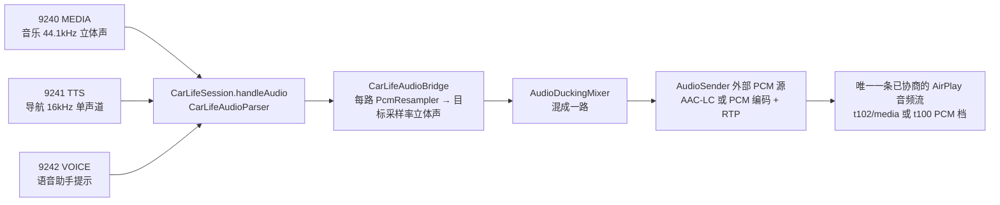

# 导航语音与音乐混音（ducking）

更新：2026-10-30。本文记录导航提示与音乐同时出现时的根因、方案选择和实现方式。**本方案只有 JVM 单测和构建证据，尚未在任何接收端或车机上听感验证**；在 `docs/CARWITH-ENTRY-FINDINGS.md` 补上带日期的实测记录之前，不代表任何接收端已经可用。

## 现有链路

- CarWith 把音乐、导航 TTS 和语音提示分三个端口发出（2026-10-27 WinPlay 1.2.5 日志：TTS `16000Hz 1ch 16bit`，与音乐分走 9240/9241，见 `docs/CARWITH-ENTRY-FINDINGS.md`）。
- `SessionController` 只为会话协商**一条**音频流（按 `AudioProfile` 候选依次 SETUP：AAC-LC 优先，失败依次退到 PCM 档），所有 CarWith 音频都经 `CarLifeAudioBridge` 送进这一条流的 `AudioSender`。

## 根因

旧版 `CarLifeAudioBridge.route()` 把三路 PCM 依次塞进同一个发送队列。为了避免两路首尾相接把时间轴拉长，它在任何 TTS/VOICE 包到达后的 500ms 内**直接丢弃所有 MEDIA PCM**（`PROMPT_HOLD_NANOS`）。因此：

1. 导航一开口音乐立即消失（不是降低音量），听感是「导航覆盖/停止音乐」；
2. 丢掉的音乐样本不会补回，提示结束后音乐从 CarWith 当前进度继续，中间那段被截掉；
3. 提示句间停顿超过 500ms 时音乐会短暂冒出来再被切断，产生突兀的跳变。

## 方案选择：手机侧混音

| 方案 | 做法 | 结论 |
| --- | --- | --- |
| A. 手机侧混音（采用） | 在编码前把音乐与提示 PCM 相加，对音乐施加增益包络 | 对所有已协商档位生效；不新增协议交互 |
| B. 接收端 duck | 再 SETUP 一条提示音频流（`type=100 audioType=default` 或 `type=101 AltAudio`），并在提示前后发 `duckAudio` / `unduckAudio` 命令，由接收端混音和压低 | 依赖各接收端实现，暂不采用 |

依据：

- **CarPlay 协议确实有方案 B 的设计。** Apple 接收端 SDK（公开镜像 `45clouds/WirelessCarPlay` 的 `AirPlayCommon.h`/`AudioUtils.h`）定义 `MainAudio=100`（低延迟）、`AltAudio=101`（UI 提示音、告警）、`MainHighAudio=102`（高延迟媒体），并有 `kAirPlayCommand_DuckAudio`（“Fade down music to play a voice prompt”）。catplay 的接收端默认能力里，`MainAudio default` 只声明 16k/24k 单声道 PCM/Opus，`AltAudio default` 声明 44.1k/48k 立体声。
- **接收端对方案 B 的支持不可依赖。** DiPlay 把 `default`/`alert` 映射到 Android 导航通道；它把 `duckAudio` 转成「申请可 duck 的音频焦点」，但这个设置默认关闭（DiPlay 0.2.22 发行说明，#946/#545）。WinPlay、MacPlay 和各车机是否接受第二条并发流、是否处理 `duckAudio` 都没有证据。
- **多一条流有已知风险。** 本项目已在 Honda/Alpine 上看到：车机接受 SETUP 却不消费某条流，约 6.5s 后拆掉整条会话（见 `AudioProfile` 注释）。为提示再开一条流会重新引入这一风险，而且 `AudioProfileMemory` 的拆链归因只针对单条流设计。
- **方案 A 与现有降级逻辑正交。** 混音发生在 `AudioSender` 之前，AAC-LC 和 PCM 两种编码拿到的都是同一份混好的立体声 PCM，档位候选、拒绝记忆和拆链归因都不变。真 iPhone 在只有一条媒体流时也是在手机侧混音。

方案 B 可以作为后续实验：先在台架上确认某个接收端在 `/info` 声明了 `type=101` 或 `type=100 default`，且能同时接受两条流，再按接收端单独启用。

## 实现

`app/src/main/java/com/mcarplay/app/audio/AudioDuckingMixer.kt`（纯逻辑，可注入时钟）与 `CarLifeAudioBridge.kt`：

- **时钟：** 音乐在播放时由音乐驱动——每来一段音乐就输出等长的一段，同时从提示缓存取同样帧数叠加，两路不会首尾相接。音乐静止（收到 MEDIA STOP/PAUSE，或 `mediaIdleMs` 内没有音乐 PCM）时，提示由 `drain()` 直接单独输出；桥接线程每 20ms 空闲轮询一次，因此音乐无声暂停时提示最多晚 `mediaIdleMs` 发出。
- **包络：** 音乐增益逐样本线性变化，压低按 `attackMs`、恢复按 `releaseMs` 走完 `1 → duckGain` 的全程，没有阶跃。提示只在音乐已淡到目标增益后才混入，首个音节不会被音乐盖住（因此音乐播放时提示整体延后约 `attackMs`）；连续提示期间音乐已处于压低状态，不再等待。
- **保持：** 提示缓存清空后再保持 `holdMs` 才开始淡回，TTS 按句分多段 INIT/DATA/END 时音乐不会在句间来回起伏。音乐从静止恢复时直接落在当前目标增益（静止时听不到音乐，不需要淡变）。
- **多路提示：** TTS 与 VOICE 各有独立缓存，同时出现时相加而不是排队。
- **防溢出：** 相加结果限幅到 s16 范围（不回绕），限幅次数计入 `clipped`；每路提示缓存上限 `maxPromptMs`，超出丢最旧样本并计入 `promptDropped`。两者都出现在 `AUDIO: CarWith 原生 PCM 接入` 的周期日志里。
- **日志：** 压低状态切换时各记一行：`AUDIO: 提示音开始，音乐压低到 -15.0dB…` / `AUDIO: 提示音结束，音乐淡回原音量…`。

默认参数（`AudioDuckingConfig`，构造 `CarLifeAudioBridge` 时可传入；目前没有界面开关）：

| 参数 | 默认 | 说明 |
| --- | --- | --- |
| `duckDb` | -15 dB | 提示期间音乐目标增益；允许 -60..0 |
| `attackMs` | 250 ms | 音乐淡出时长 |
| `releaseMs` | 400 ms | 音乐淡回时长 |
| `holdMs` | 400 ms | 最后一段提示后保持压低的时长 |
| `mediaIdleMs` | 300 ms | 判定音乐静止的无数据时长 |
| `maxPromptMs` | 8000 ms | 每路提示缓存上限 |

单测见 `app/src/test/java/com/mcarplay/app/audio/AudioDuckingMixerTest.kt`，覆盖包络单调性和步长、提示等待淡出、保持与淡回、音乐静止时单独输出、无 STOP 的音乐停顿、音乐中途恢复、多路相加、限幅、缓存溢出、分块边界不影响结果和参数校验。

## 尚未验证

- 任何接收端（DiPlay、WinPlay、MacPlay）或真实车机上的听感：压低幅度是否合适、是否有爆音、提示是否完整。
- CarWith 送 MEDIA/TTS 的实际节奏：若 TTS 远快于实时一次性送完，提示会在缓存里等待音乐节拍；若 MEDIA 分块间隔超过 `mediaIdleMs`，提示可能在音乐分块之间单独插出。需要用实机日志确认后再调参数。
- CarWith 在导航时是否自己暂停音乐（发 MEDIA_PAUSE）：若是，听感会是「音乐暂停→提示→音乐继续」，与本方案无关，需要从日志区分。
- 9240 是否也带着导航语音：小米的 MEDIA 来自 `RemoteMediaAudioProcessor`，TTS 来自 `NaviAudioManager`（见 `docs/CARWITH-ENTRY-FINDINGS.md` 2026-10-25 一节），没有证据表明二者互斥。若 MEDIA 捕获也包含导航语音，混音后会听到双重或带回声的提示；旧实现在提示期间丢弃音乐，正好掩盖了这种情况。台架上一旦听到，需要改为提示期间把音乐压到更低（如 -40dB）或回到丢弃策略，并记录证据。
- 语音助手（9242）是否也应压低音乐而不是暂停，目前与导航同等处理。

## 台架验证步骤

1. 安装本分支 standard debug 包，按常规流程连接 DiPlay、WinPlay 1.2.5 或 MacPlay，并开启声音。
2. 在 CarWith 中播放音乐，然后启动导航（模拟导航或实际路线均可），等待至少 3 条语音提示。
3. 听感检查：提示开始前音乐在约 0.25s 内平滑变小但不消失，提示清晰完整，结束后约 0.4s 停顿再在 0.4s 内恢复；全程无爆音、无卡顿、音乐不跳进度。
4. 暂停音乐后再触发导航提示：提示应单独正常播放；之后恢复音乐应直接以原音量开始。
5. 导出日志（`adb shell run-as com.mcarplay.app cat files/main_debug.log`），检查：
   - `CARLIFE: TTS 音频初始化 …`、`AUDIO: TTS PCM 16000Hz/1ch → …` 出现；
   - 每次提示各有一行 `提示音开始` 与 `提示音结束`；
   - `promptDropped` 和 `clipped` 保持为 0 或很小；
   - 导航期间是否出现 `MEDIA 音频停止 0x30003`（CarWith 自行暂停音乐）。
   - 不放音乐、只开导航时，9240 是否仍有 MEDIA PCM 到达（`MEDIA 音频初始化` 或 `MEDIA PCM … → …` 行），提示是否有回声或重音（排查 9240 是否也带导航语音）。
6. 把手机型号、HyperOS、CarWith、小米 CarLife 版本、接收端及版本、上述听感和日志摘要按日期写入 `docs/CARWITH-ENTRY-FINDINGS.md`。
