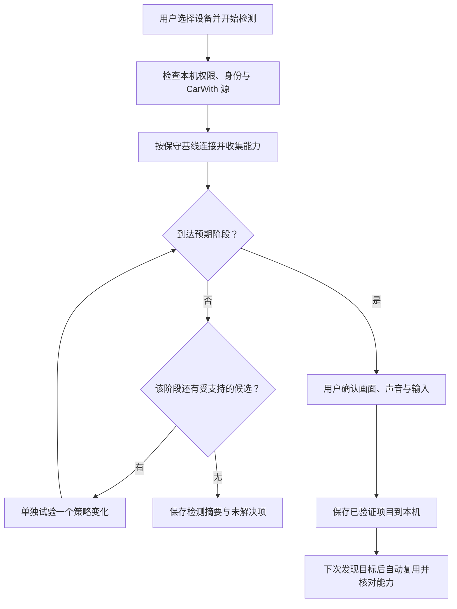

# 车机自动探测与本地适配配置：可行性研究

日期：2026-10-27。研究基线：mcarplay `d7d4960`；hypercar `4d9f6c0ea7c5c69c62ca2d50199100f2fdb7153e`。
状态：第一版检测向导已实现；下文保留研究依据与后续扩展设计，未新增任何设备或车型支持结论。

## 当前实现与使用方式

首页「连接准备 → 选择设备」选定已配对目标，再打开「检测当前车机 → 开始检测（含声音）」。
向导复用正式连接的权限检查、CarWith 原生源、iAP2、Wi-Fi 与媒体链路，不另建一套竞争连接。
面板可以收起并重新打开；检测草稿在本进程中保留，关闭面板不取消检测，杀进程会丢弃未保存草稿。

- 初次检测保留 HFP/A2DP；尚未拿到端点的蓝牙阶段，可显式运行一次「蓝牙阶段重试」。
  确认框说明会暂时断开目标的蓝牙通话／音乐。只有状态查询明确、实际有在线配置文件且断开成功，才允许记住该参数；
  查询失败不会冒充成功。不会因配对后系统自动建立连接就反复断开，也不使用设备级断开兜底。
- 端点使用本轮 `0x4301`／mDNS。仅在无端口声明、使用网关兜底且处于检测时，串行尝试 `7000/7001/7100`；
  额外候选在单个 AirPlay 客户端中只试一次。现场声明的端口不轮询，动态端点不写入永久配置。
- `/info` 默认 GET + 空 bplist；检测时仅在明确返回 `405/501` 后追加 POST 变体。
  已保存的 POST 仍只是候选，失败可回 GET；403 不触发此变体，455、超时不作为 POST 能力证据。
- 音频自动尝试现有编码器和接收端能力允许的候选。新检测不沿用或修改旧握手／音频兼容记忆；
  普通连接的握手记忆改为按本机私有接收端绑定、固件和消息能力隔离，不再共用 `unknown`。
- 实际收到 CarWith 源帧且发出视频后，可确认画面；音频确认还需要原生输入与发送计数，触控确认需要已转发的有效触点。
  用户必须确认画面正常才可保存，声音和触控可以标为未验证或有问题。音频格式只在声音确认正常时固化。
- 保存的配置按蓝牙目标的本机 HMAC 索引隔离。环境包含手机系统与 CarWith/CarLife 版本；
  音频偏好还须匹配实例、固件、features、媒体、显示与 HID 能力摘要。旧配置的连接前蓝牙／请求方法仅作有界候选。
- 草稿取消、失败或超时不会替换旧配置；保存通过后台 `AtomicFile` 原子替换，删除入口仅影响选中目标。
  私有文件为 `files/receiver-configurations.json`，最多 32 台记录、128KB；未知 schema/引擎或损坏文件保留并报告读取失败。
- 未出视频的检测总等待预算为 8 分钟；耗尽后记录 `DETECTION_TIMEOUT`，未知项目保持未验证。
  已出视频不会被该等待预算自动结束。支持报告仅含固定状态与计数，不导出私有索引和摘要，不自动上传。

第一版提供已有画面的点击／滑动确认。三点坐标拟合、诊断画面源、配置文件导入与单独的历史版本恢复尚未实现；
10 分钟稳定性及重连也不自动标为通过。下文相应内容是扩展方向，不属于已完成的设备验证。

## 结论

可以做成「用户发起一次检测 → 按阶段尝试 → 确认画面、声音、输入 → 生成本地配置 → 以后自动复用」。
用户只需选择实际连接的设备，无须选择宝马、奥迪等车型，也无须维护或下载品牌档案。

实现基础已经存在：协议能力画像、端点发现、部分握手参数记忆、音频候选与记忆、HID 格式识别、连接诊断。
新增工作主要是把这些机制收口成可取消、可归因、有试验预算的检测流程，并补上连接前的策略入口。

自动化的上限是选择 APK 已经实现的协议路径与参数。接收端需要新的封装、认证流程、输入布局或视频编码时，
单靠生成 JSON 无法增加实现。手机也无法仅凭发包证明车机已经显示画面、播放声音或正确响应触控，仍需用户确认。

## 1. hypercar 档案中哪些内容可以探测

下表是对上游字段的分析与 mcarplay 的建议，不能作为上游车型结论的独立验证。
依据为 hypercar 的[档案说明][hypercar-doc]、[字段定义][hypercar-source]与[下发 JSON][hypercar-json]。

| 差异 | 获取方式与建议 | 不能作出的推断 |
| --- | --- | --- |
| iAP2 控制 session ID | 直接使用对端链路协商中的会话表，每轮重新协商；本项目已有采纳逻辑 | 无须先识别 Audi，再写死 `1` |
| `0x4301`、`0xEA03` 是否出现 | 记录消息声明、实际到达与阶段耗时；端点可由 ctrl 邀请、mDNS 补齐；保留晚到消息入口 | 本轮没收到不等于永远不发；缺少 EA 状态回报不证明应关闭 EA |
| `0x4300`、`0xEA00`、`0x4E0E` 的发送与时序 | 以协议路径、正向能力声明和现有通用序列为基线；可选时序差异只在失败阶段做有限对照 | 稀疏清单未列出不代表明确拒绝；整组序列成功不证明其中每条都必需 |
| 端点与端口 | 每次优先采用本轮 `0x4301`／mDNS；必要时对已选接收端的少量候选端口串行试连 | TCP 接通不代表 AirPlay 可用；`455` 也可能来自方法、请求体或会话状态 |
| `/info` 的方法与请求体 | 按协议阶段请求；必要时试 APK 明确支持的请求变体，记录方法、请求体类型和响应 | 不宜在配对前盲目预热；失败不能简单归结为端口错误 |
| 音频格式 | 从 `/info` 生成 APK 支持的候选，再验证协商、原生音频输入、实际发送和用户听感 | SETUP 200、dataPort 或发包增长都不证明有声；短时断链不独立证明音频格式错误 |
| 触摸／旋钮 | 已知格式按 HID 描述符与报文识别；坐标空间错误可进一步人工校准 | 未实现的 HID 布局不能靠改宽高解决；没有触摸不证明车机没有触控能力 |
| HFP／A2DP 保留还是断开 | 需要连接前的受控对照；先保留尝试，确有需要再单独试一次断开路径 | 连接失败或 SDP 未发现服务不证明必须断开；该操作可能同时释放 ACL |
| 是否校验真实本机蓝牙地址 | 作为本机身份前置检查，能够取得真实地址时保持协议身份一致 | 单个 403 无法区分身份过滤、信任状态、配对未就绪等原因 |
| `0xAE00` 的电源订阅应答 | 若实现该协议，应按请求语义与本机实际状态响应，属于协议完善 | 不应通过尝试开关或机械重放固定三条消息来“学习车型” |
| `keepIap2AliveOnly` | 是上游配合 PC 推流的工作模式，保留为明确的产品模式选择 | 不是车机能力，不应由探测器自动切换 |

需要把「能力事实」「连接策略」「本轮运行状态」「用户确认」分开；它们不能共用一个 `verified` 布尔值。

## 2. 当前仓库可复用的部分与缺口

| 现有代码 | 已有能力 | 探测功能需要补的内容 |
| --- | --- | --- |
| [`ReceiverProfile.kt`](../app/src/main/java/com/mcarplay/app/iap2/ReceiverProfile.kt) | 归并身份、消息清单、features、srcvers，推导 Wi-Fi 与配对路径 | 用结构化证据表达声明、观察与未知；消息清单完整度仍是启发式，不能当成否定能力的证明 |
| [`ReceiverCompatibility.kt`](../app/src/main/java/com/mcarplay/app/compat/ReceiverCompatibility.kt) | 统一配对、蓝牙生命周期策略；音频记忆有实例、固件和能力摘要作用域 | 增加已验证本地配置输入、冲突处理及失效规则；现有特定软件例外仍保留其证据边界 |
| [`Iap2LinkEngine.kt`](../app/src/main/java/com/mcarplay/app/iap2/Iap2LinkEngine.kt) | 采纳对端协商的控制会话 ID | 记录协商事实即可，无须增加车型字段 |
| [`Iap2SenderSession.kt`](../app/src/main/java/com/mcarplay/app/iap2/Iap2SenderSession.kt) | 两代 Wi-Fi 信息交换、EA、晚到端点、保活与握手参数尝试 | 输出阶段事件；分离正常连接和试验写入；当前只有 `0xAE00` 标识，未见 `0xAE01` 应答实现 |
| [`MfiLengthMemory.kt`](../app/src/main/java/com/mcarplay/app/iap2/MfiLengthMemory.kt) | 成功、静默、被拒的握手长度排序 | 旧键是身份文本归一化，可能共用 `unknown` 或发生碰撞；尚未按实例、固件隔离；迟到响应归属仍需处理 |
| [`AirPlayClient.kt`](../app/src/main/java/com/mcarplay/app/airplay/AirPlayClient.kt) | 配对、GET `/info`、媒体能力、网络 iAP 状态、端点更新 | 提供结构化试验结果；不要把 403 或 455 直接变成配置字段；当前没有可配置的 `/info` 方法矩阵 |
| [`AudioProfileMemory.kt`](../app/src/main/java/com/mcarplay/app/audio/AudioProfileMemory.kt) 与 [`SessionController.kt`](../app/src/main/java/com/mcarplay/app/SessionController.kt) | 音频候选排序与约 20 秒存活窗口的记忆 | 存活结论与用户听到声音分开；短时断链作为待复核观察，排除断网、手动停止、源停止和控制链路问题 |
| [`TouchReports.kt`](../app/src/main/java/com/mcarplay/app/input/TouchReports.kt) 与 [`CarLifeTouch.kt`](../app/src/main/java/com/mcarplay/app/carlife/CarLifeTouch.kt) | 已知单指／多槽格式，车机到 CarLife 的坐标缩放 | 补 HID 坐标范围解析、校准变换与输入验证；现有解析器并非任意 HID 描述符解释器 |
| [`ConnectionDiagnostics.kt`](../app/src/main/java/com/mcarplay/app/diagnostics/ConnectionDiagnostics.kt) | 有界后台日志、按轮次的阶段和媒体计数 | 加入检测轮次、候选、结论来源、用户确认和回退原因 |

连接前有一个必须优先处理的入口：[`Iap2BluetoothClient.kt`](../app/src/main/java/com/mcarplay/app/bt/Iap2BluetoothClient.kt)
当前在出站 `tryConnect()` 之前调用 `BtProfiles.disconnect()`。自动候选虽先检查 SDP，仍未读取接收端的 iAP2 身份；
显式目标也会进入该断开流程。因此仅扩展连接后的 `ReceiverCompatibility.resolve()`，无法控制首次连接前的行为。

[`BtProfiles.kt`](../app/src/main/java/com/mcarplay/app/bt/BtProfiles.kt) 使用反射调用断开接口，查询失败还可能表现为空列表。
检测接口必须区分「确认未连接」「查询失败」「断开成功」「断开失败」，不能把空结果统一当成成功。
Android 对[非 SDK 接口][android-hidden]存在限制，探测结果还需要携带手机系统环境。

本机身份也有边界：[`DeviceIdentity.kt`](../app/src/main/java/com/mcarplay/app/util/DeviceIdentity.kt) 目前依靠 Shizuku／系统设置读取，
失败会返回占位值。Android 的 [`BluetoothAdapter.getAddress()`][android-address] 另有本机地址权限要求。
检测向导不能承诺自动消除该限制，也不能把本机身份缺失归因到车机不兼容。

## 3. 建议的用户流程

设置入口使用「检测当前车机」「重新检测」「删除本地适配记录」，无须车型下拉列表。



1. **前置检查**：确认蓝牙／WLAN／本机身份等必要条件。复用 CarWith 独立自检，但不与正式 CarPlay 会话并发争抢七路端口。
   源端没有出流时记录源端失败，不改写接收端的音视频结论。
2. **正常连接即采集**：使用已有能力协商，记录每一阶段的正向事实。能连接成功就直接进入验证，减少额外试验。
3. **仅针对失败阶段试验**：例如端点缺失时检查绑定网络和 mDNS，音频失败时仅尝试声明且已实现的格式。
   HFP／A2DP 对照放在单独的重新连接试验中；界面提前说明这一步会暂时断开蓝牙通话／音乐连接。
4. **用户验证**：手机上记录「画面正常／黑屏／比例错误」「声音正常／无声／速度异常」「点击与滑动正常／偏移／无响应」。
   允许跳过某项，也允许仅保存视频可用的部分配置；跳过项保持未验证。
5. **保存并复用**：保存候选配置和逐项验证结果。再次连接重新发现地址、端口、会话 ID，再用已成功参数决定尝试顺序。
   基础检测与长时稳定性分开；10 分钟运行及断开重连用于进一步验证，不因短测成功自动通过发布验收。

触摸偏移的高级校准可以显示三个不共线目标点，再用额外目标验证误差，拟合缩放、平移、轴交换或旋转。
必须先能正确解析原始触点；校准期间截获触点，避免落入 CarWith 操作。诊断目标还需要真正出现在接收端视频中：
当前 CarWith H.264 是直接转发，手机设置页上的覆盖层不会自动进入码流，需另行实现诊断画面源或可控的源端校准页面。
首版可先完成现有画面的输入确认，把自动坐标校准作为后续独立工作。

## 4. 探测执行与结论规则

这是分阶段的候选选择，不是遍历所有布尔字段组合。候选由 APK 内白名单定义，依赖条件也由代码定义。
第一版每个失败阶段建议最多追加两种策略变体；端口仅覆盖所选目标的少量协议候选，不扫描整个局域网。
预算耗尽返回「未确定」，保留已成功项。

- **先保存事实，再算策略**：为能力记录 `declared`、`observed`、`negotiated`、`userConfirmed` 等来源；未知用显式状态表示。
  配置保存本次成功的序列，不把成功路径自动解释成每个参数的必要条件。
- **超时保留未知**：不收到 `0x4301`、`0xEA03` 或媒体数据只说明指定窗口的观察。
  当前已有最长 5 分钟的晚到端点等待；正常路径继续响应事件，不为每个候选重复完整等待。
- **控制变量**：从上次成功状态或同一基线出发，每次只改变一个策略单元；相互依赖的消息序列作为完整单元。
  “先保留失败，后断开成功”只能形成候选偏好，仍需独立重连复核，不能直接推断因果。
- **隔离试验**：一台目标、一个活跃试验、一份有效代次。切目标、取消、断网或新轮次到来后，旧回调不得提交结果。
  有状态的握手变体使用独立连接；无法可靠关联请求与迟到响应时，只记录观察，不训练成功参数。
- **不扩大失败兜底**：普通配对超时不学习为明文能力；403 不自动触发明文、错误身份试探或主动断蓝牙。
  已存在的用户兜底开关与已核对软件例外维持独立边界，不能被探测结果扩大。
- **保留健康会话**：正在出流时不做端口轮询、额外能力副连接或蓝牙破坏性试验。
  正常运行时继续处理生命周期与晚到能力事件；检测不能另起一条持续与主会话竞争的连接。
- **强弱证据分开**：明确协议拒绝可降低候选优先级；断链、包增长和存活时长记录为观察，结合阶段与对照复核。
  目前音频的短时拆链记忆与握手响应长度记忆不能直接升级成全功能“已适配”证书。
- **事务提交**：检测中的参数先写草稿，用户保存后原子替换当前配置并保留上一份可用配置。
  取消停止本轮工作并保留旧配置；这只保证应用配置回退，不承诺恢复车机外部的配对状态。

## 5. 本地配置应保存什么

分为接收端绑定、能力证据、成功参数、验证结果四部分。下面仅展示拟议结构，字段不是现有 API，示例值不是实测结果。
`observations` 与 `validation` 的事件引用还需关联到同一检测轮次。

```json
{
  "schemaVersion": 1,
  "engineVersion": 1,
  "bindingId": "local-random-id",
  "capabilityDigest": "local-digest",
  "environmentDigest": "local-digest",
  "preferredParameters": {
    "bluetoothBringup": "keep_profiles",
    "infoRequest": "get_empty_bplist",
    "audioProfile": "supported-candidate-key"
  },
  "observations": {
    "bluetoothBringup": { "source": "trial", "status": "observed" },
    "audioProfile": { "source": "session", "status": "negotiated" }
  },
  "validation": {
    "video": "user_confirmed",
    "audio": "unverified",
    "touch": "unverified",
    "reconnect": "unverified",
    "stability": "unverified"
  }
}
```

实现时还需保存各轮的构建版本、检测时间、持续时长、原始能力的结构化摘要及逐参数的证据引用，便于解释和失效。
IP、动态端口与控制会话 ID 可以记录为历史观察，每次仍以现场协商为准；不直接保存成永久连接地址。
[Android NSD][android-nsd] 能解析服务的当前地址与端口，适合继续承担动态发现。

绑定要解决「策略生效早于身份到达」的问题：

1. 用户选中的蓝牙目标先对应一份本地绑定记录，使连接前能读取已验证的蓝牙策略。
2. iAP2／AirPlay 到达后，用实例标识、身份、固件及能力摘要复核；多服务环境无法确认对应关系时，不合并记录。
3. 接收端固件、媒体／HID 能力、手机 ROM、CarWith／CarLife 或适配引擎语义变化时，相关结论降为待复核。
   自报固件可能不变，不能单凭版本字符串认为能力没有变化；也不必因无关 UI 版本升级丢掉全部结果。

新记录使用随机本地 ID；需要按地址查找时，可在私有索引中使用带本机密钥的摘要。
没有稳定身份的未知目标只允许当前会话暂存，不能所有设备共用 `unknown`。
固件／能力尚未读取时，旧配置最多作为有界候选，失败即回到保守路径，避免旧策略阻断重新识别。

配对密钥、热点密码与本机真实 MAC 不属于可分享适配配置；连接所需材料仍由原有私有机制管理。
分享只导出脱敏摘要与允许公开的参数，不自动上传，也不把别人的实例绑定、凭据或设备地址带入导入配置。
若后续支持导入，导入值只能成为本机待验证候选，受 schema、值域与协议实现白名单限制。

## 6. 建议的实现顺序与验收

1. **先完成无额外试验的记录闭环**：新增结构化阶段事件、本地草稿和逐项确认；正常连接成功即可保存。
   复用现有 `ReceiverProfile`、`ReceiverCompatibility` 与诊断后台写入。把握手记忆迁移到可靠作用域，旧弱身份记录只作提示。
2. **接入连接前策略与有限试验执行器**：`Iap2BluetoothClient` 在断开配置文件前读取目标绑定，
   明确区分查询失败与未连接；统一检测和自动重连的所有权、取消、超时及代次。
   当前始终尝试断 HFP／A2DP 的路径不能作为所有未知设备的探测基线。
3. **补充失败阶段候选**：先覆盖端点／请求变体、蓝牙保留对照和已支持的音频格式。
   用协议事件驱动，避免解析日志文本；新协议应答和新解析器仍通过代码及测试引入。
4. **再做坐标校准与结果分享**：诊断画面源、HID 范围解析、坐标变换、复测和脱敏导出各自有清晰边界。

实现时的关键回归包括：缺失能力与明确不支持的区别、稀疏消息清单、晚到消息、同名不同实例、固件／能力变化、
403／455／断网、手动停止、CarWith 无源帧、旧轮回调、取消时不覆盖好配置、预算耗尽，以及不对健康会话发起额外试验。

设备验收按手机型号、HyperOS、CarWith／CarLife、接收端与固件分别记录。WinPlay／DiPlay 只能验证对应软件接收端的行为；
未知真实车机应验证从无本地记录开始检测、保存、杀进程后复用、至少一次重连，并独立确认画面、声音和输入。
结果可表述为「本设备本配置已验证」，仍不能外推同车型全部车机或宣称任意车机自动适配。

自动检测的实现与离线检查不替代设备验证；发布仍须遵守现有 WinPlay 1.2.4 实机门槛。

## 离线验证记录

2026-10-27：540 项 JVM 测试通过，0 失败、0 跳过；`spotlessCheck`、`lintStandardDebug` 与
`assembleStandardDebug` 通过。回归覆盖取消与旧轮回调、检测预算、音画输入证据门控、部分保存、环境变化、
私有索引及配置读写白名单、能力变化、候选限制，以及实际 TCP 上的 GET／POST 切换和 403／455 保守行为。
未进行检测向导的设备交互或实车验证，未据此通过发布门槛。

[hypercar-doc]: https://github.com/fw867/hypercar/blob/4d9f6c0ea7c5c69c62ca2d50199100f2fdb7153e/docs/HEADUNIT-PROFILES.md
[hypercar-source]: https://github.com/fw867/hypercar/blob/4d9f6c0ea7c5c69c62ca2d50199100f2fdb7153e/app/src/main/java/io/github/hypercar/headunit/HeadUnitProfile.kt
[hypercar-json]: https://github.com/fw867/hypercar/blob/4d9f6c0ea7c5c69c62ca2d50199100f2fdb7153e/profiles/headunits.json
[android-hidden]: https://developer.android.com/guide/app-compatibility/restrictions-non-sdk-interfaces
[android-address]: https://developer.android.com/reference/android/bluetooth/BluetoothAdapter#getAddress()
[android-nsd]: https://developer.android.com/develop/connectivity/wifi/use-nsd
