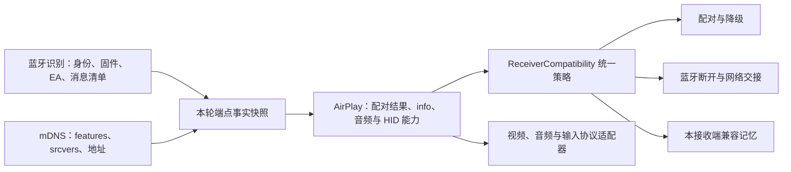

# CarPlay 接收端兼容策略

更新：2026-10-27。本文件描述代码中的兼容设计与证据范围，不是设备支持清单。软件接收端冒烟、协议回放和 JVM 测试不等于真实车机验收。

## 数据与决策分层

1. **接收端事实**：沿用 `ReceiverProfile.Signals`，扩展固件与 EA 协议。每个 `CarPlayEndpoint` 携带本条蓝牙会话的快照，包含晚到的 `0x4301` 和无凭据合成端点。mDNS 只补充已有端点，不能丢掉蓝牙身份；仅能力变化时更新策略，不关闭正在使用的 TCP。
2. **兼容策略**：`compat/ReceiverCompatibility.kt` 统一解析配对方式、蓝牙角色、断蓝牙恢复许可、真实蓝牙身份要求和记忆作用域。判定是纯函数，无进程级“上一个接收端”缓存。
3. **本轮状态**：视频是否运行、RECORD 是否成功、网络 iAP 认证是否完成独立输入。接收端自报支持某能力，不代表本轮已经完成该步骤。客户端关闭时撤回运行状态，旧虚拟链路回调不能完成新链路的认证。

协议事实优先于名称和版本先验。features 缺失与明确的零位图不同；缺失时探测配对，不能据此判定只支持明文。接收端名称可修改，软件例外需要同时匹配 EA 标识及已核对的固件画像。

## 当前策略矩阵

| 接收端信号 | 配对 | 蓝牙生命周期 | 例外与约束 |
| --- | --- | --- | --- |
| WinPlay，型号 WinPlay、制造商 Roylyl、EA `io.github.roylyl.winplay`、固件 `1.2.4` 或 `1.2.5` | 由 features 决定；SETUP 前检查真实蓝牙身份 | RECORD 和网络 iAP 认证完成后，首帧前也可保留网络会话 | 禁止借用 DiPlay 的断蓝牙重试；占位 deviceID 直接给出明确日志 |
| DiPlay，固定名称、EA `com.shilapi.xcertplay`、自报固件 `0.1.0` | 由 features 与配对应答决定 | bring-up 期间保留蓝牙；视频运行后由网络通道判断会话结束 | 仅该已识别软件画像允许原有断蓝牙恢复；403、未连通 RTSP、已配对成功仍禁止该恢复 |
| DELPHI/AUDI 且双消息清单稀疏的既有 MIB3 画像 | 由 features 与配对应答决定 | 保留原有链路协商与资源重申；不主动断蓝牙重试 | 链路代际沿用现有证据判据；不能从该画像推断车型已支持 |
| 明确未声明 HomeKit 配对能力的旧接收端 | `et=NONE` 起步；SETUP 不接受时仍可尝试加密升级 | 不主动执行软件接收端的危险恢复 | 使用原有明文事件与 AES-CTR 屏幕流路径 |
| 未知接收端、缺失信息或未核对的软件固件 | 优先探测配对；普通失败不降级明文 | bring-up 期间保留保守停止语义，视频运行时保护网络流 | 不套用其他接收端的断蓝牙例外，不共享 unknown 兼容记忆 |

所有接收端只要视频发送端正在运行，单个蓝牙 ACL/RFCOMM 断开都不能直接清理网络媒体。`CarPlayService` 的 ACL 自动收尾与 `SessionController.onSenderLinkClosed()` 的 RFCOMM 关闭共用相同决策。未启动视频、也未完成已知软件接收端网络交接时，仍按原路径取消失败轮次。

WinPlay 的“网络交接完成”必须同时满足 RECORD 成功和网络 iAP 认证完成，仅 TCP 接通、配对成功或创建发送器均不足以证明。视频已启动但 CarWith 首帧尚未到达也受媒体路径保护；后续失败由已有 CarLife、媒体与 TCP 存活检查收尾。

## 配对失败不能互相套用

- 已拿到配对密钥：无需任何失败兜底。
- 配对返回 403：不执行断蓝牙恢复、不降级明文。403 可能对应原厂就绪/信任状态，也可能对应软件接收端设备过滤，需要结合阶段和接收端日志判断。
- 超时、连接复位或普通失败：不据此推断明文能力。未知接收端禁止主动断蓝牙重试。
- 明确能力声明不支持配对，或配对端点明确返回不支持：允许明文路径。
- DiPlay 的恢复只作用于其已识别画像和本轮已连通 RTSP 的情形；恢复许可不意味着允许明文降级，两项决策独立。

## 媒体能力与记忆

- **音频**：继续从 `/info` 的 `(type, audioType, audioOutputFormats)` 生成 AAC-LC/PCM 候选，按各自采样率与延迟协商。没有清单时保留协议基线探测；明确空清单、只有不支持的编码或只有通话档位时仅推视频，不强塞 PCM 媒体流。
- **视频**：当前输入固定为 CarWith H.264，首帧由 IDR、SPS/PPS 门控，实际尺寸来自 SPS。接收端窗口、请求尺寸与实际视频尺寸分开记录；本层没有新增转码器，不能承诺接收端任意分辨率、HEVC 或高帧率。
- **输入**：继续按 HID 描述符、Usage 和报告结构解析触摸、旋钮与媒体键。描述符缺失只走已有明确回退，不因名称相似套用另一款接收端的布局。
- **记忆隔离**：音频记忆键包含接收端实例标识（端点公钥/设备标识）、型号、制造商、固件、AirPlay 栈版本、features、EA 标识与音频能力指纹。持久化仅保存摘要；没有稳定实例和身份时不读写持久化记忆。切换接收端、固件或能力变化不会沿用旧档位结论。
- **用户兜底开关**（默认关，`compat/CompatibilityPrefs`，界面在「车机设置 → 显示」）：「配对失败后尝试明文」在已连上 RTSP 的普通配对失败后恢复明文降级，403 与未连通 RTSP 仍禁止，且不影响断蓝牙重试许可；「音频格式未声明时仍尝试」在清单为空或无可用媒体格式时恢复协议基线与非媒体 PCM 档。两者是用户自担风险的旧行为，不改变默认策略矩阵。
- **定点恢复**：用户选择开启声音而旧记忆已禁用音频时，仅复位当前作用域；不清除其他接收端的记录。

`COMPAT:` 日志与连接时间线只写固定的家族、策略和规则编号，不增加原始 SSID、MAC、序列号或配对材料。策略识别与实际验证分开记录，命中一条规则不代表视频、声音、触控均已验收。

## 例外证据与版本边界

- WinPlay 1.2.5 发布构建（main [`13ccb04`](https://github.com/Roylyl/WinPlay/commit/13ccb0431b61679425767c3974fd92189c510969)）的[身份声明](https://github.com/Roylyl/WinPlay/blob/13ccb0431b61679425767c3974fd92189c510969/src/engine/iap.ts#L53)自报固件 `1.2.5`，[设备过滤](https://github.com/Roylyl/WinPlay/blob/13ccb0431b61679425767c3974fd92189c510969/src/engine/run.ts#L80)、[SETUP 403](https://github.com/Roylyl/WinPlay/blob/13ccb0431b61679425767c3974fd92189c510969/src/engine/protocol/cpStack.ts#L708)与[网络认证后释放蓝牙](https://github.com/Roylyl/WinPlay/blob/13ccb0431b61679425767c3974fd92189c510969/src/engine/run.ts#L99)与 1.2.4 相同；2026-10-27 实机断开、断网、重连对照见 `CARWITH-ENTRY-FINDINGS.md`。注意 `V1.2.5` 标签指向的提交仍自报 `1.2.4`，按该标签构建的版本会命中 1.2.4 规则。
- WinPlay V1.2.4 的[身份声明](https://github.com/Roylyl/WinPlay/blob/V1.2.4/src/engine/iap.ts#L46-L51)、[设备过滤](https://github.com/Roylyl/WinPlay/blob/V1.2.4/src/engine/run.ts#L64)、[网络认证后释放蓝牙](https://github.com/Roylyl/WinPlay/blob/V1.2.4/src/engine/run.ts#L81-L93)，以及 2026-10-27 用户关闭自动连接后的对照，见 `CARWITH-ENTRY-FINDINGS.md`。
- DiPlay v0.2.21 的[识别配置](https://github.com/shihabal3amri/DiPlay/blob/v0.2.21/common/src/main/java/com/shilapi/xcertplay/CarPlayHostActivity.kt#L194-L206)自报固件 `0.1.0`，实际型号与制造商可配置。该字段不能代表应用发行版本；规则编号因此使用 wire-0.1.0，不把所有 DiPlay 发布版本标为已验证。
- MIB3、旧协议、HFT 的现有判据来自仓库协议记录与回放。当前 CarWith 桥接版本的实车覆盖仍须按 `AGENTS.md` 补齐独立设备证据。

新增例外时，先补脱敏事实、版本范围和失败阶段，再在唯一策略文件登记并加入跨接收端回归。至少检查：未知身份、改名、版本变化、403、普通超时、首帧前后、旧回调、切换目标和记忆隔离。禁止在 Activity、Service 或音视频协议循环里新增零散品牌判断。

## 本轮离线验证范围

回归包含策略矩阵、真实 TCP 视频在 ACL 事件后的持续传输、ACL/RFCOMM 共用交接判断、蓝牙身份随初始/晚到端点传递、mDNS 仅更新能力时不关闭控制连接，以及 AAC/PCM/明确无可用音频能力的选择。构建与测试不替代 WinPlay、DiPlay 或真实车机上的完整音画触控和长时复测。

2026-10-27：493 项 JVM 测试通过（0 失败、0 跳过），`spotlessCheck`、`lintStandardDebug`、`assembleStandardDebug` 均通过；使用仓库完整 standard debug 检查命令离线验证。
